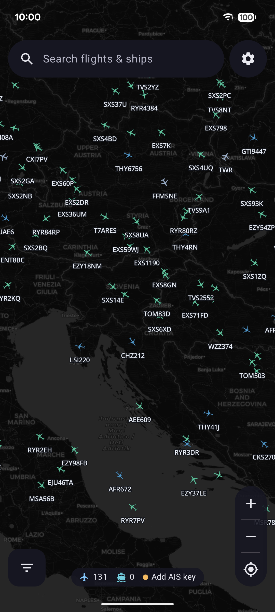
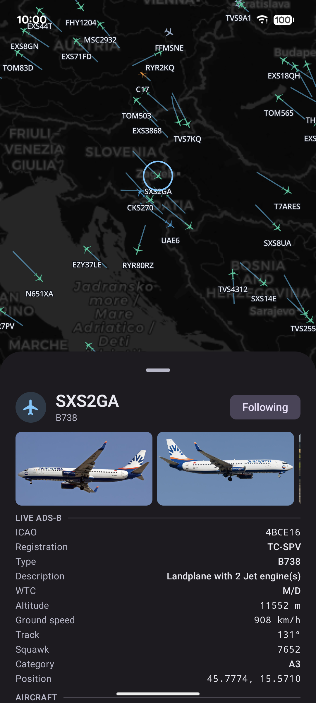
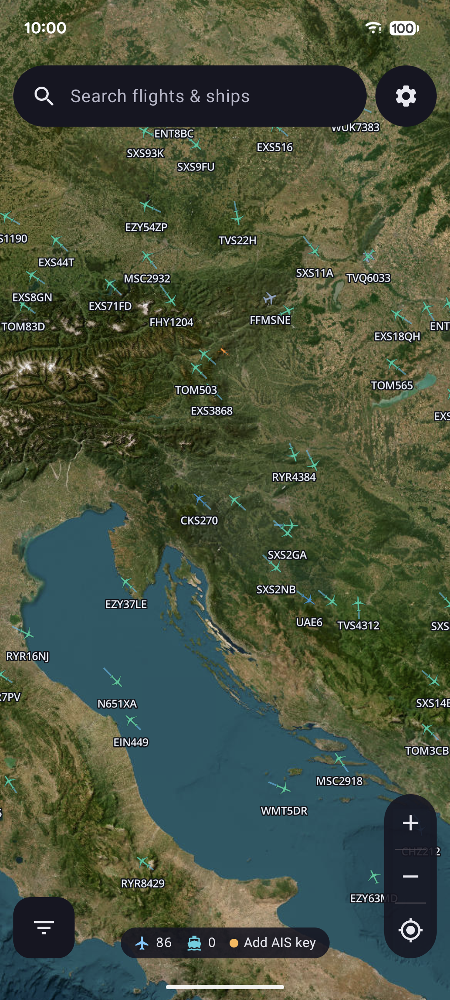

<div align="center">


# AviMar

A live air and sea traffic map for Android - aircraft from ADS-B and vessels
from AIS, drawn together in real time on a MapLibre map with selectable markers
and a per-vehicle detail sheet.

</div>

---

AviMar stands for aviation and maritime, the two things it tracks. It's a personal
project.

There's no backend of my own - it pulls everything at runtime from public
sources. Aircraft positions come from readsb-style feeds
([adsb.fi](https://adsb.fi), [adsb.lol](https://adsb.lol),
[airplanes.live](https://airplanes.live)), ship positions stream over WebSocket
from [aisstream.io](https://aisstream.io), and the map is rendered with
[MapLibre](https://maplibre.org) over CARTO, OpenStreetMap and Esri imagery
tiles.

## Screenshots

|                        Map                         |                        Detail                         |                        Satellite                         |
|:--------------------------------------------------:|:-----------------------------------------------------:|:--------------------------------------------------------:|
|  |  |  |

## What it does

- **Aircraft** - live ADS-B positions from readsb-style feeds, drawn on the map
  with heading, altitude and identity, and enriched with type, operator and
  Doc 8643 details from public aircraft databases (adsbdb, hexdb, doc8643 and a
  bundled ICAO type-designator catalog).
- **Vessels** - live AIS positions streamed over WebSocket, with vessel name,
  MMSI and type.
- **Map** - a MapLibre map with marker selection and a detail sheet for the
  selected aircraft or vessel, category filters, and switchable tile styles
  (CARTO Dark / Light / Voyager, OpenStreetMap, and an Esri satellite view).
- **Your location** - shows your position on the map.

**The feeds and parsers are fragile.** The public ADS-B and AIS endpoints, and
the scraped enrichment sources, can change their shape or go away whenever they
please - and when they do, the affected part breaks until the parser is fixed.

### Stack

Kotlin · Jetpack Compose (Material 3) · Koin · OkHttp + Retrofit +
kotlinx-serialization · DataStore · Coil · [MapLibre](https://maplibre.org)
Android SDK · AGP 9. `minSdk` 26, `targetSdk` 37.

## Building

You'll need Android Studio (or just the SDK) and a JDK; the Gradle wrapper
handles the rest.

```bash
# install the debug build on a connected device/emulator
./gradlew :app:installDebug
```

The debug app installs as **AviMar🐛** with a `.debug` suffix, so it sits happily
next to a release install.

The AIS stream needs a free [aisstream.io](https://aisstream.io) API key. Enter
it in the app's Settings - it's stored encrypted via the Android Keystore.
Aircraft tracking works without it; only the vessel layer depends on it.

### Tests

```bash
./gradlew test    # unit tests (translators, parsers, catalog) - offline
```

### Release builds

The release build is signed; the signing config is read from environment
variables to keep secrets out of the repo and play nicely with CI. Pushing a
`v*` tag triggers the release workflow, which builds and publishes signed APKs.
See [`RELEASE.md`](RELEASE.md) for keystore creation and the GitHub secrets.

```bash
export KEYSTORE_FILE=/path/to/release-key.jks
export KEYSTORE_PASSWORD=...
export KEY_ALIAS=...
export KEY_PASSWORD=...

./gradlew assembleRelease
```

## Disclaimer

AviMar is an unofficial, non-commercial hobby project. It is not affiliated with
or endorsed by any of the data sources it uses - it just displays their public
data. Positions are best-effort and not for navigation or any safety-of-life
use; for anything that actually matters, use an authoritative source.
